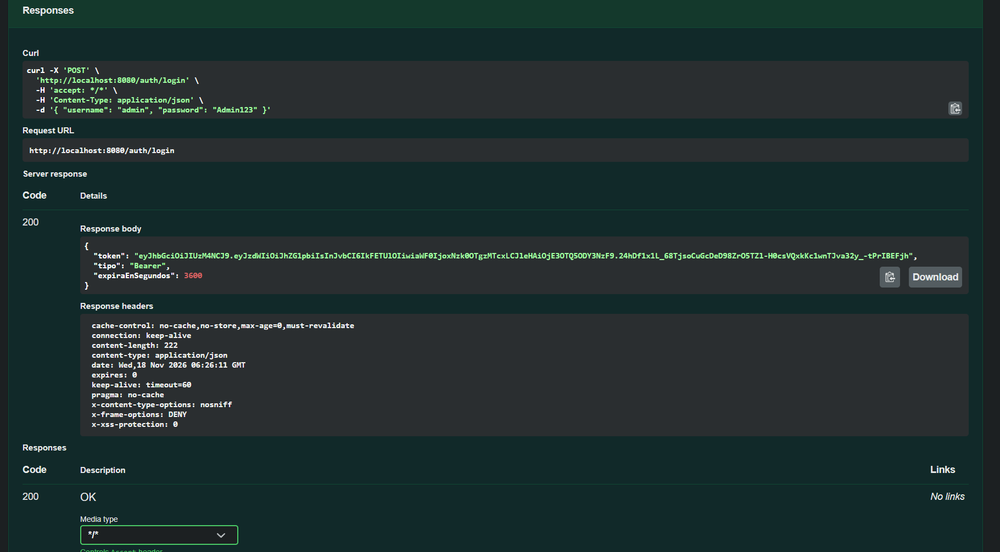
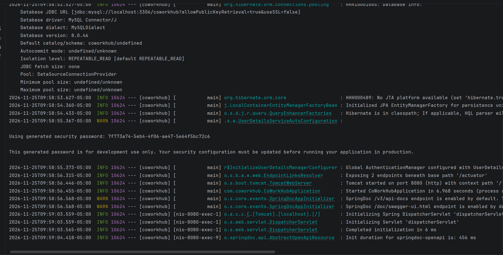
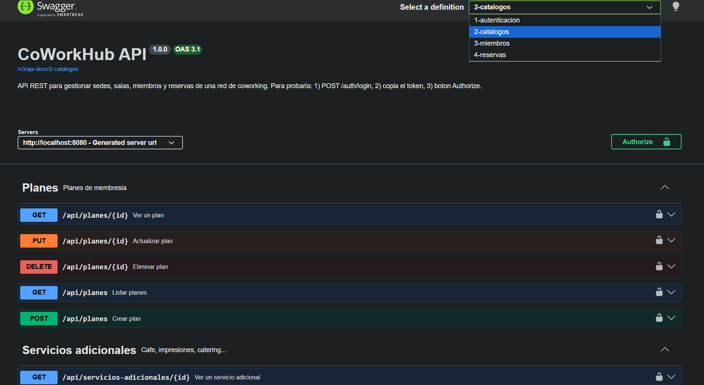
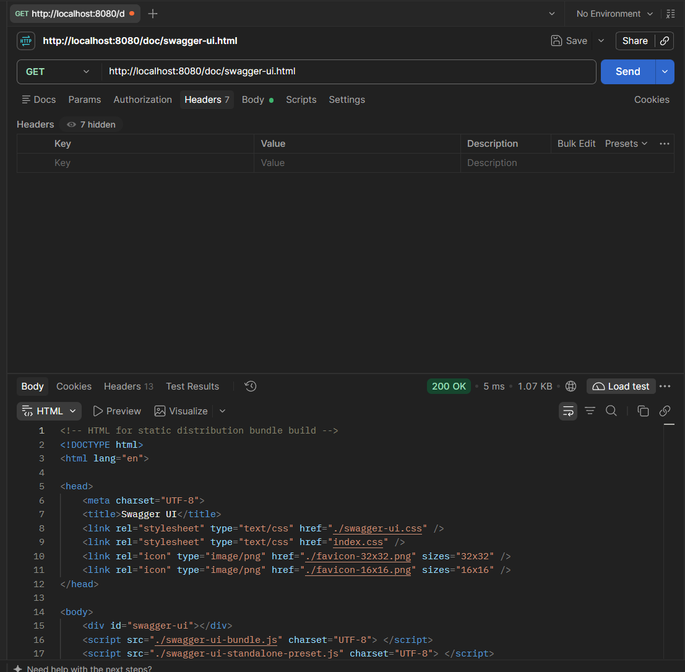
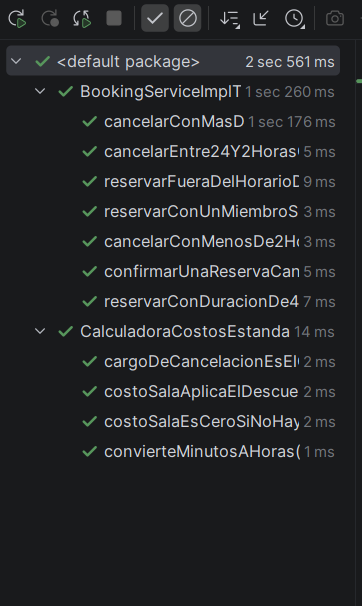
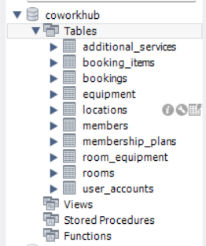
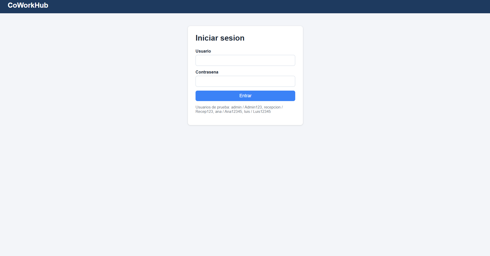
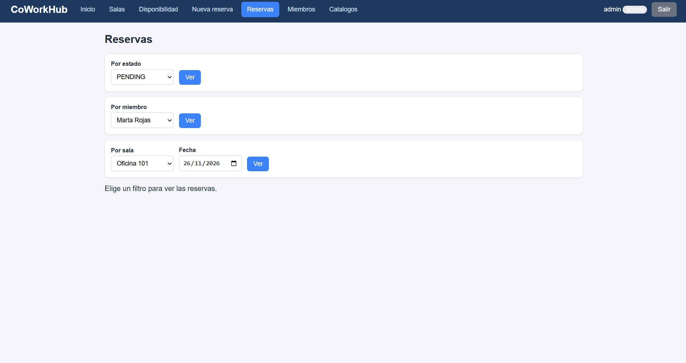
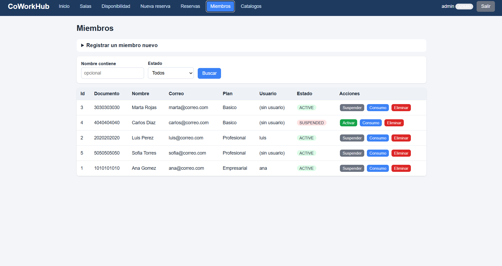

# CoWorkHub - Gestion de una red de coworking

Aplicacion web para administrar **sedes, salas, planes de membresia, miembros y reservas** de una red de coworking.
Evita las reservas duplicadas, controla las horas que consume cada miembro, cobra las cancelaciones con una regla uniforme
y deja que cada usuario vea solo lo que le corresponde segun su rol.

Esta compuesta por:
- **Backend**: API REST con Java 21, Spring Boot 4.1, Spring Data JPA, Spring Security (JWT) y MySQL.
- **Frontend**: pagina web con HTML, CSS y JavaScript que consume la API (carpeta `frontend/`).

**Integrantes:** Keynner Alonso Sanchez Ortiz (proyecto final individual, Campuslands).

## 1. Tecnologias utilizadas

| Tecnologia | Para que se usa |
|---|---|
| Java 21 + Maven | Lenguaje y construccion |
| Spring Boot 4.1 (webmvc) | API REST |
| Spring Data JPA + Hibernate + MySQL 8 | Base de datos |
| Bean Validation | Validar los DTO (`@Valid`) |
| Spring Security + JJWT | Login con token JWT, roles y `@PreAuthorize` |
| springdoc-openapi | Swagger UI y `openapi.json` |
| Actuator | `/actuator/health` |
| JUnit 5 + Mockito | Pruebas unitarias |
| HTML + CSS + JavaScript | Frontend (sin librerias) |
| Postman | Coleccion con los 14 escenarios |

## 2. Requisitos previos

- **JDK 21** o superior.
- **MySQL 8** instalado, o **Docker** para levantarlo en un contenedor.
- **IntelliJ IDEA** (trae su propio Maven). Si usas consola: Maven 3.9 o superior.
- **Git**.
- Un servidor estatico para el frontend: el de IntelliJ, Python 3, Node (`npx serve`) o la extension Live Server de VS Code.
- Postman o Insomnia (opcional, para la coleccion).

El proyecto no usa Lombok a proposito: abre en IntelliJ sin plugins ni configuracion extra.

## 3. Instrucciones de instalacion

```bash
git clone <URL-DEL-REPOSITORIO>
cd coworkhub
```

En IntelliJ: `File > Open` y elige la carpeta del proyecto (la que tiene el `pom.xml`). Si aparece el aviso
**Load Maven Project**, pulsalo y espera a que descargue las dependencias. Verifica en
`File > Project Structure` que el SDK sea **21**.

## 4. Preparar MySQL

**Opcion A - MySQL instalado.** En una consola de MySQL (como root):

```sql
CREATE DATABASE coworkhub CHARACTER SET utf8mb4;
CREATE USER 'coworkhub'@'localhost' IDENTIFIED BY 'coworkhub';
GRANT ALL PRIVILEGES ON coworkhub.* TO 'coworkhub'@'localhost';
FLUSH PRIVILEGES;
```

**Opcion B - Docker** (en Windows escribelo en una sola linea, sin las `\`):

```bash
docker run -d --name coworkhub-mysql \
  -e MYSQL_DATABASE=coworkhub \
  -e MYSQL_USER=coworkhub \
  -e MYSQL_PASSWORD=coworkhub \
  -e MYSQL_ROOT_PASSWORD=root \
  -e TZ=America/Bogota \
  -p 3306:3306 \
  -v coworkhub-datos:/var/lib/mysql \
  mysql:8.4
```

Espera a que `docker logs coworkhub-mysql` muestre `ready for connections` antes de arrancar el backend.
Si el puerto 3306 esta ocupado usa `-p 3307:3306` y cambia el puerto en `DB_URL` (ver seccion 5).
(`TZ=America/Bogota` hace que MySQL tenga la misma hora que tu PC; si no, las reservas de prueba quedan corridas.)

No hay que crear tablas ni ejecutar scripts a mano: con `ddl-auto=create`, **en cada arranque** Hibernate borra las tablas,
las crea y ejecuta `src/main/resources/import.sql` con los datos de prueba. El archivo `migration.sql` es la copia del
mismo script para el repositorio.

## 5. Configuracion mediante variables de entorno

Todo se puede cambiar sin tocar el codigo. Si la variable no existe, se usa el valor por defecto.

| Variable | Valor por defecto | Para que sirve |
|---|---|---|
| `DB_URL` | `jdbc:mysql://localhost:3306/coworkhub?allowPublicKeyRetrieval=true&useSSL=false` | Direccion de MySQL |
| `DB_USERNAME` | `coworkhub` | Usuario de MySQL |
| `DB_PASSWORD` | `coworkhub` | Contrasena de MySQL |
| `SERVER_PORT` | `8080` | Puerto del backend |
| `JWT_SECRET` | (una clave de desarrollo) | Clave para firmar los tokens. Minimo 32 caracteres. **Cambiala fuera de desarrollo** |
| `JWT_EXPIRATION_MINUTES` | `60` | Duracion del token |
| `CANCELACION_PORCENTAJE` | `50` | Porcentaje que se cobra al cancelar entre 24 h y 2 h |
| `CORS_ORIGINS` | puertos 5500, 8000, 3000, 5173, 8081 y 63342 | Direcciones desde donde se permite abrir el frontend (separadas por coma) |

**Configuracion local sin subir contrasenas a GitHub:** copia `src/main/resources/local.properties.example` como
`src/main/resources/local.properties` y pon tu usuario y clave de MySQL. Ese archivo esta en `.gitignore`, asi que no se
sube al repositorio, y sus valores reemplazan a los de `application.properties`. Las variables de entorno de arriba
siguen funcionando y tienen prioridad sobre `local.properties`.

Como ponerlas:
- **IntelliJ**: `Run > Edit Configurations > CoWorkHubApplication > Modify options > Environment variables` y escribe, por ejemplo,
  `DB_USERNAME=root;DB_PASSWORD=miclave`.
- **PowerShell**: `$env:DB_USERNAME="root"; $env:DB_PASSWORD="miclave"; mvn spring-boot:run`
- **CMD**: `set DB_USERNAME=root` y `set DB_PASSWORD=miclave`, y luego `mvn spring-boot:run`
- **Linux / Mac / Git Bash**: `export DB_USERNAME=root DB_PASSWORD=miclave`

## 6. Ejecucion

### Backend
- **IntelliJ**: abre `CoWorkHubApplication.java` y pulsa el triangulo verde junto a `main`.
- **Consola**: `mvn spring-boot:run`

Cuando veas `Started CoWorkHubApplication`, la API esta en <http://localhost:8080>.
Comprobacion rapida: <http://localhost:8080/actuator/health> debe responder `{"status":"UP"}`.

### Frontend
Con el backend encendido, sirve la carpeta `frontend/` con UNA de estas opciones:

- **IntelliJ**: abre `frontend/index.html` y pulsa el icono de navegador de la esquina superior derecha del editor.
- **Python**: `cd frontend` y `python -m http.server 5500`, luego abre <http://localhost:5500>.
- **VS Code**: extension *Live Server* > *Open with Live Server*.
- **Node**: `cd frontend` y `npx serve -l 5500`.

No lo abras con doble clic (`file://`), porque el navegador bloquea las llamadas a la API.
Si el backend usa otro puerto, cambia `API_URL` en `frontend/js/config.js`.
Si sirves el frontend en un puerto que no esta en la lista de `CORS_ORIGINS`, agregalo a esa variable.

Lo que ve cada usuario en el frontend:

| Pantalla | ADMIN | RECEPTIONIST | MEMBER |
|---|---|---|---|
| Inicio (resumen) | si | si | si (sus horas del mes) |
| Salas y disponibilidad | si | si | si |
| Nueva reserva | para cualquier miembro | para cualquier miembro | solo a su nombre |
| Reservas (ver, detalle, servicios, cancelar) | todas | todas | solo las suyas |
| Confirmar y completar reservas | si | si | no |
| Miembros (registrar, suspender, activar, consumo) | si | si | no |
| Catalogos (sedes, salas, equipamientos, servicios, planes) | si | no | no |
| Mi consumo de horas | - | - | si |

## 7. Usuarios de prueba y descripcion de roles

| Usuario | Contrasena | Rol |
|---|---|---|
| `admin` | `Admin123` | ADMIN |
| `recepcion` | `Recep123` | RECEPTIONIST |
| `ana` | `Ana12345` | MEMBER (miembro 1, plan Empresarial) |
| `luis` | `Luis12345` | MEMBER (miembro 2, plan Profesional) |

| Rol | Que puede hacer |
|---|---|
| **ADMIN** | Todo: administra los catalogos (sedes, salas, equipamientos, servicios, planes), los miembros y todas las reservas |
| **RECEPTIONIST** | Registra y gestiona miembros, crea reservas a nombre de cualquier miembro, y confirma, cancela o completa reservas. No cambia los catalogos |
| **MEMBER** | Solo ve y reserva lo suyo: sus reservas, su consumo de horas y el catalogo de salas. Si pide algo de otro miembro recibe 403 |

Otros miembros de prueba (sin usuario): Marta (3), Carlos (4, **suspendido**) y Sofia (5).
Reservas de prueba para cancelar: **13** (empieza en 31 h), **14** (en 5 h) y **15** (en 1 h), todas de Ana.

## 8. Swagger y otros enlaces locales

| Enlace | Para que |
|---|---|
| <http://localhost:8080/doc/swagger-ui.html> | **Swagger UI** (probar la API desde el navegador) |
| <http://localhost:8080/v3/api-docs> | Contrato OpenAPI en JSON |
| <http://localhost:8080/actuator/health> | Salud de la aplicacion |

En Swagger: `POST /auth/login` > copia el `token` > boton **Authorize** > pegalo (sin escribir "Bearer").

## 9. Como probar

1. **Frontend**: inicia sesion con los usuarios de prueba y prueba cada pantalla.
2. **Swagger UI**: ver seccion 8.
3. **Postman / Insomnia**: importa `postman/CoWorkHub.postman_collection.json`. Reinicia el backend, corre primero la carpeta
   *00 - Login* y luego *Escenarios del enunciado* (los 14 escenarios, cada peticion trae sus tests).
4. **curl** (en Windows usa `curl.exe`):
```bash
curl -X POST http://localhost:8080/auth/login -H "Content-Type: application/json" -d "{\"username\":\"admin\",\"password\":\"Admin123\"}"
curl http://localhost:8080/api/sedes -H "Authorization: Bearer PEGA_AQUI_EL_TOKEN"
```
5. **Pruebas unitarias**: `mvn test` (o clic derecho en `src/test` > *Run 'All Tests'* en IntelliJ).

## 10. Contrato OpenAPI

El archivo `docs/openapi.json` se regenera con el backend encendido:
```bash
curl http://localhost:8080/v3/api-docs -o docs/openapi.json
```

## 11. Evidencias de funcionamiento

**Login en Swagger (200 con token JWT):**



**Backend arrancado:**



**Swagger UI:**



**Coleccion de Postman con los 14 escenarios:**



**Pruebas unitarias:**



**Base de datos con los datos de prueba:**



**Frontend:**





---

# 12. Como funciona

## 12.1 Arquitectura en capas

```
Cliente (Postman/Swagger)
   |  JSON
   v
presentation   Controladores REST + ManejadorExcepciones      (reciben y responden, no tienen logica)
   |  DTO (records)
   v
business       Servicios (interfaz + implementacion), calculo de costos, excepciones, Mapeador
   |  entidades
   v
persistence    Entidades JPA, enums y repositorios Spring Data
   |
   v
MySQL
```

- Un **controlador** nunca habla con un repositorio: llama a un servicio.
- Las **entidades nunca salen por la API**: el `Mapeador` las convierte en DTO (`record`). Asi no hay problemas de lazy loading ni se filtra la contrasena.
- Los servicios son `interface` + `Impl`; se inyectan por **constructor**.
- Hay dos `CalculadoraCostos` (una estandar y otra sin descuento): la estandar es `@Primary` y el servicio de reservas la pide con `@Qualifier("calculadoraEstandar")`.
- `ConfiguracionValidator` (`@PostConstruct`) revisa al arrancar que el secreto JWT tenga 32 caracteres o mas.

## 12.2 Modelo de datos

```
Location 1---N Room N---N Equipment          (tabla intermedia room_equipment)
MembershipPlan 1---N Member 1---1 UserAccount
Member 1---N Booking N---1 Room
Booking 1---N BookingItem N---1 AdditionalService
```

| Relacion | Lado dueno (tiene la clave foranea) |
|---|---|
| Room -> Location | `Room` (`location_id`) |
| Room <-> Equipment | `Room` (tabla `room_equipment`) |
| Member -> MembershipPlan | `Member` (`plan_id`) |
| Member -> UserAccount | `Member` (`user_account_id`, 1 a 1, con cascade) |
| Booking -> Room / Member | `Booking` (`room_id`, `member_id`) |
| BookingItem -> Booking / AdditionalService | `BookingItem` |

- Todas las relaciones son `LAZY`. Los listados usan `@EntityGraph` para traer lo necesario en **una sola consulta** (evita el problema N+1).
- Los precios son `BigDecimal` (nunca `double`).
- `BookingItem.appliedUnitPrice` guarda el precio del servicio **el dia que se agrego**; si el precio cambia despues, la reserva no cambia.
- Restricciones `unique`: documento y correo del miembro, usuario, nombre de plan, equipamiento y servicio, y nombre de sala **dentro de una sede**.

## 12.3 Que pasa cuando llega una peticion

1. `JwtAuthFilter` lee el header `Authorization: Bearer <token>`. Si el token es valido, deja en el contexto al usuario (nombre, rol y `miembroId`). Si no es valido, no autentica.
2. `SecurityConfig` decide: `/auth/login`, Swagger y `/actuator/health` son publicos; todo lo demas necesita estar autenticado. Sin token o con token malo responde **401**.
3. El controlador valida el cuerpo con `@Valid` (si falla: **400**) y revisa permisos con `@PreAuthorize` (si falla: **403**).
4. El servicio aplica las reglas de negocio (si se rompe una: **409** con su codigo `RN-xx`).
5. Si algo no existe: **404**.
6. Todos los errores salen con el mismo formato:
```json
{ "error": "La sala ya esta reservada en ese horario", "codigo": "RN-01", "timestamp": "2030-06-03T13:00:00Z" }
```

## 12.4 Seguridad

- Las contrasenas se guardan con **BCrypt**.
- `POST /auth/login` devuelve un JWT firmado (HS256) que dura 60 minutos (`app.jwt.expiration-minutes`). Lleva el usuario, el rol y el `miembroId`.
- Roles: `ADMIN` (todo), `RECEPTIONIST` (reservas y miembros) y `MEMBER` (solo lo suyo).
- **Dueno del recurso (RN-13)**: el bean `PermisosService` (`@permisos`) se usa dentro de `@PreAuthorize`, por ejemplo `hasAnyRole('ADMIN','RECEPTIONIST') or @permisos.esReservaPropia(#id)`. Un MEMBER solo ve y cancela sus reservas, y solo reserva a su nombre.

| Recurso | ADMIN | RECEPTIONIST | MEMBER |
|---|---|---|---|
| Ver sedes, salas, equipamientos, servicios, planes, disponibilidad | si | si | si |
| Crear/editar/eliminar esos catalogos | si | no | no |
| Miembros (listar, registrar, editar, suspender, activar) | si | si | no |
| Eliminar miembro | si | no | no |
| Ver miembro y su consumo | si | si | solo el suyo |
| Crear reserva | si | si | solo a su nombre |
| Ver / listar / cancelar / cambiar servicios de una reserva | si | si | solo las suyas |
| Confirmar y completar reserva | si | si | no |

## 12.5 Reglas de negocio y donde estan

| Regla | Que hace | Donde |
|---|---|---|
| RN-01 | Una sala no puede tener dos reservas activas que se crucen. Si una termina justo cuando empieza otra, **no** se cruzan | `BookingServiceImpl.create` + `BookingRepository.countOverlaps` |
| RN-02 | Duracion de 30 min a 8 h, en multiplos de 30 min, dentro del mismo dia | `BookingServiceImpl.create` |
| RN-03 | Dentro del horario de la sede, en el futuro y con minimo 1 h de anticipacion | `BookingServiceImpl.create` |
| RN-04 | Sala activa y asistentes <= capacidad | `BookingServiceImpl.create` |
| RN-05 | Un miembro suspendido no puede reservar | `BookingServiceImpl.create` |
| RN-06 | Maximo de reservas activas futuras segun el plan | `BookingServiceImpl.create` |
| RN-07 | Costo de la sala con horas incluidas y descuento (ver 12.6) | `BookingServiceImpl.create`, `CalculadoraCostos`, `ConsumoHoras` |
| RN-08 | Cancelacion segun anticipacion (ver 12.7) | `BookingServiceImpl.cancel` |
| RN-09 | Estados: PENDING > CONFIRMED > COMPLETED; solo se cancela PENDING o CONFIRMED | `confirm`, `complete`, `cancel` |
| RN-10 | Los servicios adicionales solo se cambian si la reserva esta PENDING | `addService`, `removeService` |
| RN-11 | Unicidad (documento, correo, usuario, nombres) | Servicios de catalogos y miembros + `unique` en la base |
| RN-12 | No se borra lo que esta en uso (sede con salas, sala/miembro con reservas, plan con miembros, equipamiento en salas, servicio en reservas) | Metodos `delete` de cada servicio |
| RN-13 | Un MEMBER solo accede a lo suyo | `PermisosService` + `@PreAuthorize` |

Orden en que se revisa al crear una reserva: sala y miembro existen (404) > RN-05 > RN-04 > RN-02 > RN-03 > RN-01 > RN-06 > costo.

## 12.6 Como se calcula el costo (RN-07)

1. Se suman las horas que el miembro ya uso en el mes de la reserva (reservas PENDING, CONFIRMED y COMPLETED).
2. Horas libres = horas incluidas del plan - horas usadas (minimo 0).
3. Horas excedentes = horas de la reserva - horas libres (minimo 0).
4. `costo de la sala = horas excedentes x tarifa por hora x (100 - descuento del plan) / 100`.
5. `costo de servicios = suma(cantidad x precio aplicado)` y `total = sala + servicios`.

Ejemplo: plan Basico (5 h incluidas, 10 % de descuento). Ya uso 4 h este mes y reserva 3 h de una sala de 40.000/h:
libres = 1 h, excedentes = 2 h, costo = 2 x 40.000 x 0,90 = **72.000**.

`GET /api/miembros/{id}/consumo?mes=2030-06` devuelve horas incluidas, usadas, restantes y excedentes.

## 12.7 Cancelacion (RN-08)

| Anticipacion | Resultado |
|---|---|
| 24 h o mas | Se cancela **sin cargo** y las horas vuelven al plan |
| Entre 24 h y 2 h | Se cancela con cargo del **50 %** del costo de la sala (`app.cancelacion.porcentaje`); las horas siguen contando como usadas |
| Menos de 2 h (o ya empezo) | **409 RN-08** |

## 12.8 Reservas simultaneas (concurrencia)

Si dos personas reservan la misma sala a la vez, las dos podrian pasar la validacion de cruce y quedar duplicadas.
Para evitarlo, `create` es `@Transactional` y **lo primero** que hace es leer la sala con **bloqueo pesimista** (`select ... for update`, `RoomRepository.findByIdForUpdate`).
La segunda peticion espera a que termine la primera y entonces si ve la reserva nueva: recibe **409 RN-01**.
En Postman, los escenarios 13a y 13b envian la misma reserva: la primera responde 201 y la segunda 409 con `RN-01`.

## 12.9 Endpoints

| Metodo | Ruta | Que hace |
|---|---|---|
| POST | `/auth/login` | Iniciar sesion (publico) |
| GET | `/auth/perfil` | Usuario, rol y miembroId del token |
| GET/POST/PUT/DELETE | `/api/sedes`, `/api/sedes/{id}` | CRUD de sedes |
| GET/POST/PUT/DELETE | `/api/salas`, `/api/salas/{id}` | CRUD de salas (`?sedeId=`) |
| GET/POST/PUT/DELETE | `/api/equipamientos`, `/api/equipamientos/{id}` | CRUD de equipamientos |
| GET/POST/PUT/DELETE | `/api/servicios-adicionales`, `/{id}` | CRUD de servicios adicionales |
| GET/POST/PUT/DELETE | `/api/planes`, `/api/planes/{id}` | CRUD de planes |
| GET/POST | `/api/miembros` | Listar (`?nombre=&estado=`) y registrar |
| GET/PUT/DELETE | `/api/miembros/{id}` | Ver, actualizar, eliminar |
| PATCH | `/api/miembros/{id}/suspender` y `/activar` | Cambiar estado |
| GET | `/api/miembros/{id}/consumo?mes=yyyy-MM` | Consumo de horas |
| GET | `/api/disponibilidad` | `sedeId, fecha, horaInicio, horaFin, capacidadMinima, equipamientoIds` |
| POST/GET | `/api/reservas` | Crear y listar (`?miembroId=` o `?salaId=&fecha=` o `?estado=`) |
| GET | `/api/reservas/{id}` | Ver reserva |
| POST/DELETE | `/api/reservas/{id}/servicios[/{servicioId}]` | Agregar / quitar servicio |
| POST | `/api/reservas/{id}/confirmar`, `/cancelar`, `/completar` | Cambiar estado |
| GET | `/actuator/health` | Salud (publico) |

Ejemplo de cuerpo para crear una reserva:
```json
{
  "miembroId": 1,
  "salaId": 2,
  "startTime": "2030-06-03T10:00:00",
  "endTime": "2030-06-03T12:00:00",
  "attendees": 3,
  "services": [ { "servicioId": 1, "quantity": 2 } ]
}
```

## 12.10 Estructura del proyecto

```
coworkhub/
|-- pom.xml
|-- README.md
|-- docs/openapi.json, docs/evidencias/
|-- frontend/            pagina web (HTML, CSS y JavaScript)
|-- postman/CoWorkHub.postman_collection.json
`-- src/
    |-- main/java/com/coworkhub/
    |   |-- CoWorkHubApplication.java
    |   |-- config/         AppConfig, OpenApiConfig, ConfiguracionValidator
    |   |-- security/       SecurityConfig, JwtService, JwtAuthFilter, PermisosService, ...
    |   |-- dto/            records de entrada y salida
    |   |-- presentation/   controladores + ManejadorExcepciones
    |   |-- business/       service/ (interfaces) service/impl/ calculo/ exception/ mapper/
    |   `-- persistence/    entity/ enums/ repository/
    |-- main/resources/     application.properties, import.sql, migration.sql
    `-- test/java/com/coworkhub/   pruebas unitarias
```

## 12.11 Decisiones y supuestos

- Los nombres de campos del JSON siguen los atributos de las entidades (`name`, `startTime`, ...). Los ids de relaciones y los filtros van en espanol (`sedeId`, `miembroId`, `salaId`, `servicioId`, `equipamientoIds`).
- Si se agrega dos veces el mismo servicio a una reserva, se suma la cantidad en la misma linea.
- Una cancelacion tardia (con cargo) mantiene las horas como usadas; una cancelacion con 24 h o mas las devuelve.
- Las horas de un mes se cuentan por la fecha de inicio de la reserva.
- `docs/openapi.json` incluido fue armado a partir de los endpoints del proyecto; la version exacta que genera la app se obtiene con el comando `curl` de la seccion 6.
- Orden de desarrollo sugerido por el curso: modelo y repositorios > servicios y reglas > controladores > validacion y errores > seguridad (primero Basic Auth y luego JWT) > Swagger > pruebas. Esta version final ya usa JWT.

## 12.12 Pruebas unitarias

`mvn test` (o clic derecho en la carpeta `test` de IntelliJ > Run). Cubren el calculo de costos, la cancelacion (sin cargo, 50 % y menos de 2 h), confirmar una reserva cancelada y las reglas RN-02, RN-03 y RN-05 al crear una reserva.
